# Architecture

## The four layers

Dependencies flow inward only. A module may import only from layers at or above it in this list
(per `AGENTS.md`, enforced by `npm run lint` via `scripts/verify-module-boundaries.mjs`):

### 1. `src/domain/` — pure contracts and logic

No `chrome` namespace, no DOM, no I/O. No imports from any other `src/` layer.

- `types.ts` — `TabStatus`, `QueueReading`, `Session`, `SessionState`, `RankedReading`,
  `Metrics`, `Snapshot`.
- `errors.ts` — the tagged `AppError` union and `describeError`/`detailOf`.
- `result.ts` — the `Result<T, E>` algebra (`ok`, `err`, `isOk`, `isErr`, `unwrapOr`, `mapOk`).
- `messages.ts` — `PopupCommand`/`ContentReading` contracts and their parsers
  (`parsePopupCommand`, `parseContentReading`).
- `session.ts` — the session state machine (`applyCommand`, `nextState`, `canTransition`,
  `createSession`, `withTabIds`, `addTabId`, `removeTabIds`, `withSeq`, `isActive`).
- `rank.ts` — `rank()` and `readyTabs()`.
- `readings.ts` — staleness (`isStale`, `staleFraction`, `ageMs`), merging (`mergeReading`,
  `mergeReadings`, `latestByTab`), ordering (`orderByTabIds`), and `closeReading`.
- `validation.ts` — `validateUrl`, `validateCount`, `validateTarget`, `isAllowedHost` — the only
  place that turns an untrusted string count and string URL into values the rest of the
  extension may act on.

### 2. `src/platform/` — ports to the browser

The only layer permitted to touch the `chrome` namespace.

- `browser.ts` — the port interfaces (`TabsPort`, `StoragePort`, `Clock`, `Timers`, `IdSource`,
  `Platform`) that every other layer depends on.
- `chromeBrowser.ts` — the real `chrome.tabs`/`chrome.storage`/`chrome.windows` implementations
  of those ports (`createChromeTabs`, `createChromeStorage`, `createChromePlatform`,
  `systemClock`, `systemTimers`, `cryptoIds`). This is an I/O boundary with **no automated test
  coverage** — see [docs/testing.md](./testing.md) "known gaps."
- `storageCodec.ts` — parses whatever comes back out of `chrome.storage` into `Session`/
  `QueueReading[]`, dropping anything that doesn't validate rather than trusting its shape.

### 3. `src/app/` — workflows

Depends on `src/domain/` and on `src/platform/browser.ts` **interfaces only**, never on
`chromeBrowser.ts`.

- `store.ts` — `createStore`: loads/saves session + readings, and `reconcile()`s tracked tab IDs
  against the browser's live tab list.
- `poller.ts` — `createPoller`: runs one polling round with bounded concurrency and per-tab
  timeouts, merging each response through the sequence-number guard.
- `metrics.ts` — `computeMetrics`: turns a `RoundResult` into the `Metrics` the popup renders
  (reads/s, mean/P95 latency, stale fraction, round duration).
- `coordinator.ts` — `createCoordinator`: the single owner of session state. Every command —
  from the popup, from a tab-closure event, from a recovered worker — funnels through here so the
  popup and the background never mutate the same session independently.

### 4. `src/background/`, `src/popup/`, `src/content/` — thin entry points

Wire concrete implementations to the layers above. Kept deliberately thin — this is "the least
testable code in the repo" per `AGENTS.md`.

- `src/popup/format.ts` — pure string formatting (`formatAge`, `formatProgress`, `formatScore`,
  `formatThroughput`, `formatFreshness`, `statusLabel`). No DOM.
- `src/popup/render.ts` — pure DOM rendering against elements handed in by the caller
  (`resolveElements`, `bindHandlers`, `render`). Builds every row with `document.createElement`
  and `.textContent`, never `innerHTML`.
- `src/popup/index.ts` — the actual entry point: wires `chrome.runtime.sendMessage` to
  `render.ts`, and polls `GET_SNAPSHOT` once a second while the popup document is open.
- `src/content/adapters/` — `types.ts` (the `QueueAdapter` contract), `progressElement.ts` (the
  one shipped adapter, for the repo's own `<progress id="queue">` fixture), `index.ts` (the
  adapter registry and `selectAdapter`).
- `src/content/reader.ts` — `readQueue(doc, seq)`: turns a `Document` into a `ContentReading`
  using whichever adapter matched.
- `src/content/index.ts` — the actual content-script entry point: validates inbound
  `chrome.runtime.onMessage` payloads and answers synchronously with `readQueue`'s result.
- `src/background/index.ts` — the service worker entry point: wires `createChromePlatform()` to
  `createCoordinator`/`createPoller`/`createStore`/`createRoundLoop`, listens on
  `chrome.runtime.onMessage` for `PopupCommand`s (parsing every inbound message with
  `parsePopupCommand` before acting on it), reconciles on `platform.tabs.onRemoved`, and
  rehydrates on `chrome.runtime.onStartup`/`onInstalled`.
- `src/background/roundLoop.ts` — `createRoundLoop`: the thing that actually decides when another
  polling round happens. See the dedicated section below.

## Data flow

```mermaid
flowchart LR
    Popup["Popup UI\n(src/popup)"] -->|PopupCommand| Background["Background entry point\n(src/background/index.ts)"]
    Background --> Coordinator["Coordinator\n(src/app/coordinator.ts)"]
    Coordinator --> Validation["Validation\n(src/domain/validation.ts)"]
    Validation -->|allowlisted URL + count| TabCreate["Tab creation\n(TabsPort.create)"]
    TabCreate --> ContentRead["Content-script read\n(src/content, TabsPort.read)"]
    ContentRead --> Merge["Merge + sequence guard\n(src/domain/readings.ts, src/app/poller.ts)"]
    Merge --> Snapshot["Snapshot build\n(rank + readyTabs + metrics)"]
    Snapshot --> PopupRender["Popup render\n(src/popup/render.ts)"]
    PopupRender --> Popup
```

Walking it in words:

1. A user action in the popup (Start/Pause/Resume/Stop/Focus) becomes a `PopupCommand`, sent via
   `chrome.runtime.sendMessage` (`src/popup/index.ts`).
2. The background entry point receives it and hands it to the coordinator
   (`Coordinator.handle`).
3. For `START`, the coordinator revalidates the URL and tab count against the allowlist
   (`validateTarget` in `src/domain/validation.ts`) — the popup's own client-side check is a
   convenience only, never the actual gate.
4. On success, the coordinator opens tabs one at a time via `TabsPort.create`, persisting the
   session after each one so a partial failure is never rounded up to "all tabs opened."
5. Once monitoring, each round (`Coordinator.tick`) asks the poller to read every tracked tab
   (`TabsPort.read`, which messages the content script and applies a per-tab timeout).
6. The content script (`src/content/index.ts` → `reader.ts` → the matched adapter) answers with
   a `ContentReading` containing only `type`, `seq`, `status`, `progress`, and `adapter` — never
   page text, URLs, or form values.
7. The poller merges each response against the previously accepted reading for that tab via the
   sequence-number guard (`mergeReading`): a response whose `seq` isn't strictly newer is
   discarded, not merged.
8. The coordinator builds a `Snapshot`: tracked-tab-ordered readings, a ranked subset
   (`rank()`), the `ready` tabs, and round metrics (`computeMetrics`).
9. The snapshot is persisted (session to `chrome.storage.local`, readings to
   `chrome.storage.session` when available) and returned to the popup, which renders it with
   `src/popup/render.ts` — every value via `.textContent`, never `innerHTML`.

## State machine

```mermaid
stateDiagram-v2
    [*] --> idle
    idle --> starting : START
    idle --> stopped : STOP
    starting --> monitoring : ACTIVATE
    starting --> stopped : STOP
    monitoring --> paused : PAUSE
    monitoring --> monitoring : ACTIVATE / RESUME (no-op)
    paused --> monitoring : RESUME
    paused --> paused : PAUSE (no-op)
    monitoring --> stopped : STOP
    paused --> stopped : STOP
    stopped --> starting : START
    stopped --> stopped : STOP (no-op)
```

This diagram is taken directly from the `TRANSITIONS` table in `src/domain/session.ts`, which is
kept as data (not a `switch`) specifically so this diagram and the code can't drift apart.
`PAUSE` while paused, `RESUME` while monitoring, `ACTIVATE` while monitoring, and `STOP` while
stopped are idempotent no-ops: they succeed and return the session unchanged (including
`updatedAt`) rather than erroring. Every other `(state, command)` pair not shown above is a
genuinely invalid transition and returns `err({ kind: "invalid-transition", from, command })`.

`ACTIVATE` is an internal command, issued by the coordinator itself once tab creation finishes
during `START` — it is not one of the four buttons in the popup.

## Why scheduling lives in the background entry point, not the poller

The poller (`src/app/poller.ts`) only knows how to run *one* round when asked — it has no opinion
about when the next round should happen. That's deliberate: an MV3 service worker can be
suspended by Chrome at any time between events, which means any scheduling mechanism that lives
only in in-memory worker state (a `setInterval` handle held in a module-level variable, for
example) can simply vanish without warning. A round loop built that way would silently stop
polling and have no way to notice.

`src/background/roundLoop.ts`'s `createRoundLoop` is where this is actually decided, and it ties
scheduling to a live controlling context rather than to a timer sitting in worker memory: the
popup reports in (`loop.noteContact()`) every time it sends a command — including its once-a-second
`GET_SNAPSHOT` heartbeat from `src/popup/index.ts` — and the loop keeps calling
`coordinator.tick()` (with a `ROUND_GAP_MS` = 500ms gap between rounds) for as long as
`coordinator.shouldPoll()` is true *and* the last popup contact was within `POPUP_IDLE_MS` =
5,000ms. No popup open, no recent contact, or the session isn't `monitoring`, and the loop simply
doesn't restart itself — there is no dangling `setInterval` to leak, because there never was one.

This is also why `Coordinator.tick()` and `shouldPoll()` are designed to be safe to call
repeatedly and idempotently from whatever live context invokes them: `src/background/index.ts`
also calls `coordinator.hydrate()` from `chrome.runtime.onStartup`/`onInstalled`, so a worker that
was killed and restarted reloads the session from `chrome.storage` and reconciles tracked tabs
against the browser's live tab list before anything resumes, rather than trusting whatever was in
memory before the suspension. A session left `monitoring` with no popup watching it does not spin
forever in the background, either — it simply goes quiet until a popup reopens and makes contact
again, at which point its readings are already correctly shown as stale by their age, not as
current.
